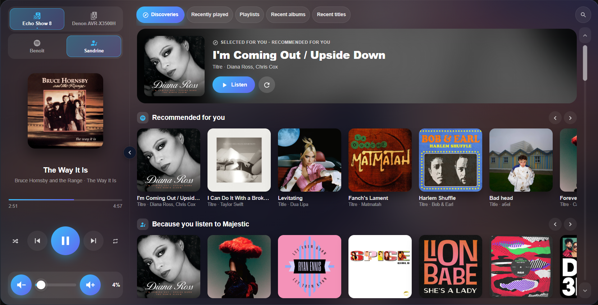
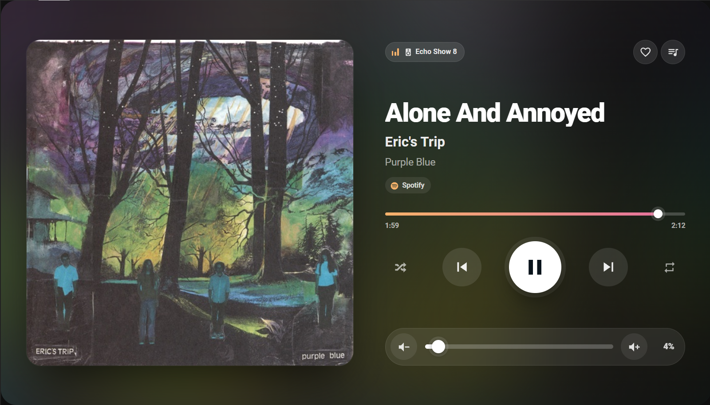

# Kiosk Music Assistant Cards

Kiosk Music Assistant Cards for Home Assistant.

[](https://my.home-assistant.io/redirect/hacs_repository/?owner=benoitpoirier&repository=ha-kiosk-musicassistant-cards&category=integration)

Touch-first Lovelace cards for [Music Assistant](https://music-assistant.io/), designed for wall tablets, Echo Show / Nest Hub style kiosks and any touch screen running a Home Assistant dashboard.

The package is a Home Assistant custom integration that:

- serves and automatically loads the cards in the Home Assistant frontend (no manual Lovelace resource needed);
- exposes helper actions that reuse Home Assistant's already authenticated Music Assistant client, so no Music Assistant token is ever sent to the browser.

## Why you will like it

- **Multi-player**: pick your speakers from Music Assistant's own player list (one entry per device, whatever the protocol), group them and switch between them with one tap. The card follows whichever player is playing.
- **Multi-source**: browse and search the whole Music Assistant library (Spotify, Tidal, YouTube Music, Deezer, local files, radios...) from one place. Each source can be tied to a Music Assistant user, so every family member gets their own library and recommendations.
- **Discover tab**: fresh recommendations right in the browser, built from similar tracks of your listening history and from Music Assistant's own rows. It works with any provider and does not require Spotify.
- **Smart queue**: play a single track and similar tracks are queued behind it once it has started, so the music never stops and playback is never delayed.
- **Now playing with a real queue**: preview the queue, remove tracks, and see what is coming next, in a full-screen player.
- **Synchronised lyrics** that scroll with the music, shown only when time-coded lyrics are available.
- **8 colour themes** (sunset, spotify, ocean, aurora, neon, ember, graphite, daylight), with accents shared by both cards.
- **Touch first**: big targets, an on-screen keyboard for search, a light non-blocking playback pill, and a layout tuned for 1280×800 kiosks that also adapts to phones in portrait.
- **Fully configurable**: visual editors for both cards, and YAML options for everything (zones, sources, categories, theme, language, height, discovery, queue behaviour...).
- **Kiosk automations that don't break**: a *Music playing* sensor follows Music Assistant itself, and a *Hide player buttons* switch turns the now-playing card into a clean display.
- **Zero setup on the frontend**: installed through HACS, loaded automatically, no Lovelace resource to add and no build step. Available in English, French and Dutch.
- **Safe by design**: Music Assistant's token never reaches the browser; the cards reuse Home Assistant's authenticated client.

## Screenshots

Browser card (1280×800 kiosk):



Now playing card (1280×800 kiosk):



## Cards

| Card | Type | Description |
| --- | --- | --- |
| Browser | `custom:kiosk-musicassistant-card` | Player, speaker switching, a *Discover* tab with new tracks recommended from your listening history (and Music Assistant rows), library categories, search with on-screen keyboard and navigation buttons in a single card. Visual editor included. |
| Now playing | `custom:kiosk-musicassistant-now-playing` | Full-screen now-playing view: cover art, progress, transport, volume, queue preview, synchronised lyrics and optional Spotify favourites. Visual editor included. |

Interface languages: English, French and Dutch (follows Home Assistant, or set `language`).

Both cards are responsive and tuned for a 1280×800 kiosk (Echo Show 8 class): the tile grid adds columns and enlarges the artwork as the screen gets wider.

## What's new

See the [CHANGELOG](CHANGELOG.md) for the full history.

- **Music playing sensor** (1.11): follows Music Assistant players and groups directly, so kiosk automations keep working when a player gets a new Home Assistant entity id.
- **Pick a speaker, not an entity** (1.8 – 1.9): the editors only list Music Assistant players, one per device. Music Assistant chooses the protocol (HEOS, AirPlay, DLNA…) itself, so the many Home Assistant entities of one device no longer matter. Wrong or stale entities are flagged with a one-click replacement, matched by name or by device model.
- **Speaker groups from Music Assistant** (1.9): `group_with` and `solo` replace the old join/unjoin options; a player synced to a group is followed through its leader.
- **Each person gets their own Discover feed** (1.10): Music Assistant's play-log rows are global, so for a music source they are replaced by rows from that user's library; Top Picks follow the user too.
- **Instant source switching** (1.10): similar-track feeds survive restarts and the other sources are warmed in the background; the rows keep their place while recommendations load.
- **One source for the whole dashboard** (1.10): the now-playing card follows the source picked in the browser card (`follow_source`).

## Requirements

- Home Assistant with the official **Music Assistant** integration configured.
- Tested with Home Assistant 2026.10 and Music Assistant 2.10.
- Optional: [SpotifyPlus](https://github.com/thlucas1/homeassistantcomponent_spotifyplus) for the favourite (heart) button of the now-playing card.

## Installation

### HACS (recommended)

One click: [](https://my.home-assistant.io/redirect/hacs_repository/?owner=benoitpoirier&repository=ha-kiosk-musicassistant-cards&category=integration) opens the repository in HACS on your instance (it asks to add it as a custom repository if needed). Then continue at step 3. Or do it by hand:

1. HACS > three-dot menu > **Custom repositories**.
2. Add `https://github.com/benoitpoirier/ha-kiosk-musicassistant-cards` with type **Integration**.
3. Install **Kiosk Music Assistant Cards** and restart Home Assistant.
4. **Settings > Devices & services > Add integration > Kiosk Music Assistant Cards**.
5. Reload the browser (clear the cache on kiosk devices if needed).

### Manual

Copy `custom_components/kiosk_musicassistant_cards` to `<config>/custom_components/`, restart Home Assistant and add the integration as above.

## Browser card

Add it from the card picker: when only one Music Assistant instance exists, it is selected automatically and a default set of categories is created. Every option below is available in the visual editor, except `radio_delay` and `radio_lag` (YAML only).

### Minimal example

```yaml
type: custom:kiosk-musicassistant-card
config_entry_id: <your_music_assistant_config_entry_id>
```

Without `zones`, every Music Assistant player is listed. Without `categories`, four default categories are used (top picks, recently played, recently added, playlists). Both cards accept `zones` or `players` with the same item format; a player synced to a group is followed through its group leader.

### Full example

```yaml
type: custom:kiosk-musicassistant-card
config_entry_id: <your_music_assistant_config_entry_id>
fill: true
language: en
volume_max: 60
volume_start: 25
volume_step: 2
tile_action: open
zones:
  - name: Living room
    icon: mdi:sofa
    entity: media_player.living_room
    volume: media_player.living_room_amplifier
    before:
      turn_off: media_player.whole_house_group
  - name: Downstairs
    icon: mdi:speaker-multiple
    entity: media_player.kitchen
    before:
      join:
        leader: media_player.kitchen
        members:
          - media_player.dining_room
music_sources:
  - name: Alice
    icon: mdi:spotify
    username: alice
    connect_entity: media_player.spotify_alice
    spotify_entity: media_player.spotifyplus_alice
  - name: Bob
    icon: mdi:spotify
    username: bob
categories:
  - name: Top picks
    source:
      media_type: recommendations
      limit: 9
  - name: Favourite albums
    source:
      media_type: album
      favorite: true
      order_by: last_played_desc
      limit: 24
  - name: Radio
    tiles:
      - name: My radio
        uri: library://radio/1
        play: true
      - name: Chill mix
        uri: library://playlist/65
        icon: mdi:weather-night
        radio_mode: true
links:
  - name: Home
    icon: mdi:home
    path: /lovelace/0
```

### General options

| Option | Default | Description |
| --- | --- | --- |
| `config_entry_id` | **required** | Music Assistant config entry. |
| `height` | `556` | Card height in pixels. |
| `fill` | `false` | Fill the remaining screen height below the card (ignores `height`). |
| `fill_margin` | `8` | Bottom margin in pixels when `fill` is enabled. |
| `arrows` | `true` | Scroll buttons and a draggable scrollbar next to lists (for devices where touch scrolling is unreliable, e.g. cast displays). Also adds left/right buttons to the Discover carousels. |
| `show_player` | `true` | Show the player column on the left. A round chevron handle in the middle of the line between player and browser hides or shows it; while hidden and playing, the handle is outlined in the accent colour. This option sets the initial state. |
| `discover` | `true` | Show the *Discover* tab (first tab, opened by default). |
| `discover_source` | `mixed` | `similar`: new tracks recommended by your music providers (Spotify, Tidal, YouTube Music, Deezer… any Music Assistant provider with similar tracks), seeded with your listening history. `music_assistant`: Music Assistant's own rows only — no streaming service needed. `mixed`: similar tracks first, then Music Assistant rows. `spotify` is accepted as the former name of `similar`. |
| `spotify_entity` | none | Optional SpotifyPlus `media_player` whose Spotify history seeds the recommendations when the selected music source has no `spotify_entity`. |
| `discover_hidden_rows` | `true` | Also show the rows Music Assistant hides by default (random, forgotten, most played, ...). `false` keeps only the default rows. YAML only. |
| `kiosk_theme` | `true` | Kiosk styling with large touch targets. Set to `false` to follow the plain Home Assistant theme. |
| `theme` | `sunset` | Colour theme of the kiosk styling: `sunset` (peach & pink), `spotify` (green on black), `ocean` (cyan & indigo), `aurora` (mint & lavender), `neon` (pink & violet), `ember` (amber & red), `graphite` (monochrome) or `daylight` (light). |
| `language` | HA language | `en`, `fr` or `nl`. |
| `volume_max` | `100` | Maximum volume (%); also the end of the slider. |
| `volume_start` | none | When playback starts while the volume is above `volume_max`, drop back to this value (%). |
| `volume_step` | `1` | Volume button step (%). |
| `tile_action` | `open` | `open` shows the tracks of a tile, `play` plays it straight away. |
| `transfer_on_switch` | `true` | Ask whether to move the queue to the new speaker (stopping the current one) when switching zones while playing. `false` never asks and never moves. |
| `retry_next` | `true` | Re-send *next/previous* once if nothing happened after 2.5 s (some Chromecast players). |
| `autofill_similar` | `true` | When the track that plays is the last one of the queue, queue 10 similar tracks from your music providers. Runs in the background, so it never delays playback. |
| `full_modal` | `false` | Show the detailed step-by-step modal while a track starts. By default a light pill with an animated icon and a short phrase is shown instead. |
| `keyboard` | `false` | `false` uses a regular text field and the device keyboard. `true` uses the built-in on-screen keyboard. |
| `limit` | `24` | Search results per media type. |
| `search_types` | all | Subset of `track`, `album`, `artist`, `playlist`. |
| `radio_delay` | `0` | Delay (s) applied to radio title/artwork changes so they match the audio buffer. |
| `radio_lag` | `0` | Stay this many titles behind for stations that announce the next song early. |

### `zones` (speakers)

| Option | Description |
| --- | --- |
| `name`, `icon` | Label and icon of the button. |
| `entity` | Music Assistant `media_player` to play on. |
| `volume` *(legacy YAML)* | Optional `media_player` that receives volume-slider changes (e.g. an amplifier). Still honoured; prefer the Music Assistant per-player volume control setting. |
| `volume_max`, `volume_start`, `volume_step` | Per-zone overrides of the general options. |
| `group_with` | List of Music Assistant players to join to this zone's player before playing, using Music Assistant groups. |
| `solo` | Detach this zone's player from any group before playing. |
| `before.turn_off` | Player to switch off before playing on this zone. |
| `before.unjoin` *(legacy YAML)* | Still honoured. The visual editor converts it to `solo` when its player is the zone player. |
| `before.join.leader` / `before.join.members` *(legacy YAML)* | Still honoured. The visual editor converts it to `group_with` when the leader is the zone player. |

Use Music Assistant players for playback, with one MA player per physical device. MA merges a device's protocols and chooses the output protocol itself (for example HEOS, AirPlay or DLNA). The visual editors list MA players and flag configured non-MA entities with a suggested replacement when one can be matched. Suggestions also cover stale Music Assistant entities left behind when Music Assistant recreates a player under a new ID (for example, after switching to a universal player), matching by name or by the device model in the Home Assistant registries. The now-playing editor offers the same one-click replacement. A player synced to a group is followed through its group leader.

### `music_sources` (Music Assistant users)

Lets several people switch between their own accounts (for example one Spotify account each). Requires Music Assistant users whose provider filter selects the matching account.

| Option | Description |
| --- | --- |
| `name`, `icon` | Label and icon of the button. |
| `username` | **Required.** Music Assistant username. |
| `connect_entity` | Optional Spotify `media_player` of this account. No longer used: switching source keeps the current playback running. |
| `spotify_entity` | Optional [SpotifyPlus](https://github.com/thlucas1/homeassistantcomponent_spotifyplus) `media_player` of this account. Its Spotify listening history (top tracks of the last weeks, recently played) seeds the *Discover* recommendations. |

The selected source is remembered per dashboard in the browser local storage and shared with the now-playing card on that dashboard.

### `categories`

A category is either a hand-made list (`tiles`) or a list filled by Music Assistant (`source`).

`tiles[]`: `name`, `uri` (Music Assistant media id, required), `image` (optional cover URL), `icon`, `play` (play directly), `radio_mode`.

To find a media id: **Developer tools > Actions > Music Assistant: Search**, enable response, and copy the `uri` of the result (for example `library://playlist/65`).

`source`:

| Option | Description |
| --- | --- |
| `media_type` | `recommendations`, `playlist`, `album`, `artist`, `track` or `radio`. |
| `limit` | Number of tiles (1 to 100; up to 500 in YAML for library types). |
| `order_by` | `name`, `last_played_desc`, `timestamp_added_desc`, `random` or empty for library order. |
| `favorite` | Favourites only. |
| `search` | Optional text filter. |
| `play`, `radio_mode` | Tile behaviour. |

### Discover tab

The *Discover* tab proposes music as horizontal carousels, with a featured pick on top:

- **Similar tracks** (`discover_source: similar` or `mixed`): *Recommended for you* and *Because you listen to …* rows of new tracks. A handful of tracks from your listening history are picked as seeds and your music providers return similar tracks through Music Assistant (`music/tracks/similar_tracks`, the call behind Music Assistant's radio mode). This works with any provider that offers similar tracks (Spotify, Tidal, YouTube Music, Deezer…). The seeds are the tracks last played and the favourite tracks in Music Assistant; with a SpotifyPlus `spotify_entity`, your Spotify top tracks of the last weeks and recently played tracks are used instead, so the recommendations follow your whole Spotify history. The result is cached by the integration for 2 hours and rebuilt in the background (feeds used in the last day are checked every 10 minutes), so the tab opens instantly; the refresh button forces a rebuild with other seeds. Spotify removed its recommendation endpoints from the public Web API in November 2024; Music Assistant's Spotify provider still reaches them with its own session.
- **Music Assistant rows** (`music_assistant` or `mixed`): the rows of Music Assistant's home screen (recently played, recently added, random, forgotten, most played…). These play-log rows are global in Music Assistant; when a `music_sources` user is selected, they are replaced by rows from that user’s library: recently played tracks, albums and artists, most played tracks, and favourites.

Similar-track feeds are persisted across Home Assistant restarts. Once the current Discover feed has loaded, the card also requests similar-track feeds for the other configured music sources in the background (at most once per user every 20 minutes), so switching source can show a warm cache immediately.

Tapping a recommended track plays it and queues the rest of the row.

**Without Spotify:** nothing to configure — with `mixed`, similar tracks come from whichever provider you use, and when none can recommend (local files only, radio…) the tab shows Music Assistant's rows. Set `discover_source: music_assistant` to skip the similar-track lookup, or `discover: false` to hide the tab. Tap a cover to open an album, playlist or artist; tap the round play button to play it straight away. With `music_sources`, the rows are fetched for the selected Music Assistant user. The feed is cached for 10 minutes; the refresh button reloads it.

### `links`

Navigation buttons inside the card, so a kiosk view can consist of a single card: `name`, `icon`, `path` (for example `/dashboard-kiosk/menu`).

## Now playing card

```yaml
type: custom:kiosk-musicassistant-now-playing
config_entry_id: <your_music_assistant_config_entry_id>
fill: true
language: en
volume_step: 5
players:
  - name: Living room
    entity: media_player.living_room
  - name: Kitchen
    entity: media_player.kitchen
favorite_accounts:
  spotify--abc123: media_player.spotifyplus_alice
```

| Option | Default | Description |
| --- | --- | --- |
| `config_entry_id` | none | Music Assistant config entry. Required for the queue preview and lyrics. |
| `height` | `560` | Card height in pixels (420 to 780). `0` (or `auto`) = Auto: fill the remaining screen height below the card, e.g. a full-screen panel view on a kiosk. The legacy `fill: true` still works. |
| `fill_margin` | `8` | Bottom margin in pixels in Auto height. |
| `language` | HA language | `en`, `fr` or `nl`. |
| `players` | all Music Assistant players | Players to follow (same items as the browser card `zones`, which is also accepted). Only Music Assistant players are offered by the visual editor. The card shows the one that is playing (or the most recently paused). When several play at once, buttons let you choose. |
| `volume_step` | `1` | Volume button step (%). The -/+ buttons repeat while held. |
| `theme` | `sunset` | Accent colours, same names as the browser card `theme`. |
| `autofill_similar` | `true` | When the track that plays is the last one of the queue, queue 10 similar tracks. |
| `follow_source` | `true` | When no `username` is set, follow the Music Assistant source selected in the browser card on the same dashboard. |
| `show_buttons` | `true` | `false` hides every button (player switch, favourite, queue, lyrics, transport, volume). |
| `show_progress` | `true` | Show the progress bar. It stays visible when the buttons are hidden and moves to the bottom of the column, larger. |
| `show_player` | `true` | Show the current player pill. |
| `show_favorite` / `show_queue` / `show_lyrics` | `true` | Show the favourite, queue and lyrics buttons. |
| `title_size` / `artist_size` / `album_size` | `54` / `29` / `21` | Text sizes in px while the buttons are shown. |
| `title_size_no_buttons` / `artist_size_no_buttons` / `album_size_no_buttons` | `100` / `50` / `36` | Text sizes in px while the buttons are hidden (`show_buttons: false` or the *Hide player buttons* switch is on). |
| `username` | none | Music Assistant user used to look up similar tracks. Overrides `follow_source`. |
| `favorite_accounts` | none | Maps a provider instance id to a SpotifyPlus `media_player` to show a favourite (heart) button for the current track. |

Synchronised lyrics are shown only when Music Assistant provides time-stamped (LRC) lyrics for the current track.

### Hide player buttons switch

The integration creates a switch, *Hide player buttons* (device *Kiosk Music Assistant Cards*). While it is on, every now-playing card hides all its buttons and uses `font_scale_no_buttons`; while it is off (the default) the buttons are shown. The state survives restarts. Turn it on and off from an automation, for example while a screensaver is active:

```yaml
triggers:
  - trigger: state
    entity_id: switch.my_screensaver_active
actions:
  - action: "switch.turn_{{ trigger.to_state.state }}"
    target:
      entity_id: switch.kiosk_music_assistant_cards_hide_player_buttons
```

### Music playing sensor

The integration creates a *Music playing* binary sensor that is on while any available, enabled Music Assistant player or group is playing. It reads Music Assistant's player list directly rather than watching a fixed list of Home Assistant `media_player` entity ids. This matters because Music Assistant can recreate a player under a new id (for example, `media_player.denon_avr_x3500h_3` becoming `_4`), and one physical device can also have several Home Assistant entities. The sensor follows every Music Assistant player and group, regardless of those entity ids.

Its `players`, `player_ids` and `entity_ids` attributes list the currently playing players by name, Music Assistant id and matching Home Assistant entity id. The sensor becomes unavailable when Music Assistant is disconnected.

Entity ids follow the language Home Assistant had when the integration was added: `binary_sensor.kiosk_music_assistant_cards_music_playing` and `switch.kiosk_music_assistant_cards_hide_player_buttons` in English, `binary_sensor.kiosk_music_assistant_cards_musique_en_cours` and `switch.kiosk_music_assistant_cards_masquer_les_boutons_du_lecteur` in French. Check yours under *Settings > Devices > Kiosk Music Assistant Cards*.

Use the state trigger to show the kiosk dashboard when music starts, and also check the sensor after Home Assistant starts. When it has been off for 30 seconds, return to the screensaver mode. Replace the example select entity and option names with those provided by your kiosk integration.

```yaml
automation:
  - alias: Kiosk - show dashboard while music plays
    triggers:
      - trigger: state
        entity_id: binary_sensor.kiosk_music_assistant_cards_music_playing
        to: "on"
      - trigger: homeassistant
        event: start
    conditions:
      - condition: state
        entity_id: binary_sensor.kiosk_music_assistant_cards_music_playing
        state: "on"
    actions:
      - action: select.select_option
        target:
          entity_id: select.my_tablet_screensaver_mode
        data:
          option: Home Assistant Dashboard

  - alias: Kiosk - return to screensaver when music stops
    triggers:
      - trigger: state
        entity_id: binary_sensor.kiosk_music_assistant_cards_music_playing
        from: "on"
        to: "off"
        for: "00:00:30"
    actions:
      - action: select.select_option
        target:
          entity_id: select.my_tablet_screensaver_mode
        data:
          option: Screensaver
```

## Example: wall kiosk with Kiosk Satellite

This setup runs on an Echo Show 8 with the *Kiosk Satellite* app. A `dashboard-kiosk` dashboard uses panel views: `menu` (home), `lecture` (now-playing card) and `music-browser` (browser card). Four automations turn the tablet into a music display:

- while music plays anywhere in the house, the screensaver shows the now-playing view instead of the weather, without dimming;
- when nothing has played for 30 seconds, the weather screensaver and dimming come back;
- when the screen wakes up, it opens the now-playing view if music is playing, otherwise the menu;
- while the screensaver is on, the player buttons are hidden, leaving a large cover and title readable from across the room.

The automations never name a speaker: they watch the [Music playing sensor](#music-playing-sensor), which follows Music Assistant itself. They keep working when Music Assistant re-creates a player under a new entity id, they cover every room and group, and the weather does not come back while another speaker is still playing. To react to one room only, add a condition on the sensor's `entity_ids` or `players` attribute.

Replace `echo_show_8` with the name of your Kiosk Satellite device, and the sensor and switch ids with yours (see the note on entity ids above). In Kiosk Satellite, set the *Home Assistant Dashboard* screensaver to the `dashboard-kiosk/lecture` view.

```yaml
- id: kiosk_music_start
  alias: Kiosk - music starts, now-playing screensaver
  triggers:
    - trigger: state
      entity_id: binary_sensor.kiosk_music_assistant_cards_music_playing
      to: "on"
    # Music already playing when Home Assistant restarts.
    - trigger: homeassistant
      event: start
  conditions:
    - condition: state
      entity_id: binary_sensor.kiosk_music_assistant_cards_music_playing
      state: "on"
  actions:
    - action: select.select_option
      target:
        entity_id: select.echo_show_8_screensaver_mode
      data:
        option: Home Assistant Dashboard
    - action: switch.turn_off
      target:
        entity_id: switch.echo_show_8_screensaver_brightness
  mode: restart

- id: kiosk_music_end
  alias: Kiosk - music stops, weather screensaver
  triggers:
    # 30 s absorb track changes and short pauses.
    - trigger: state
      entity_id: binary_sensor.kiosk_music_assistant_cards_music_playing
      from: "on"
      to: "off"
      for: "00:00:30"
  actions:
    - action: select.select_option
      target:
        entity_id: select.echo_show_8_screensaver_mode
      data:
        option: Weather Mood
    - action: switch.turn_on
      target:
        entity_id: switch.echo_show_8_screensaver_brightness
  mode: restart

- id: kiosk_wake_view
  alias: Kiosk - dashboard view around the screensaver
  triggers:
    - trigger: state
      entity_id: switch.echo_show_8_screensaver_active
      from: "off"
      to: "on"
      id: start
    - trigger: state
      entity_id: switch.echo_show_8_screensaver_active
      from: "on"
      to: "off"
      id: stop
  actions:
    - variables:
        target: >-
          {{ 'dashboard-kiosk/lecture'
             if is_state('binary_sensor.kiosk_music_assistant_cards_music_playing', 'on')
             else 'dashboard-kiosk/menu' }}
    # On start, only prepare the now-playing view behind the screensaver.
    - condition: template
      value_template: "{{ trigger.id == 'stop' or target == 'dashboard-kiosk/lecture' }}"
    # Avoid reloading a view that is already shown.
    - condition: template
      value_template: "{{ not states('sensor.echo_show_8_current_page').endswith('/' ~ target) }}"
    - action: select.select_option
      target:
        entity_id: select.echo_show_8_dashboard_view
      data:
        option: "{{ target }}"
  mode: restart

- id: kiosk_hide_controls
  alias: Kiosk - hide player buttons during screensaver
  triggers:
    - trigger: state
      entity_id: switch.echo_show_8_screensaver_active
      to: ["on", "off"]
    - trigger: homeassistant
      event: start
  actions:
    - action: >-
        switch.turn_{{ 'on' if is_state('switch.echo_show_8_screensaver_active', 'on') else 'off' }}
      target:
        entity_id: switch.kiosk_music_assistant_cards_hide_player_buttons
  mode: restart
```

Kiosk Satellite keeps control of when the screensaver starts (its inactivity timeout): the automations only choose what it shows and never force it on.

The cards on this dashboard need no speaker entity ids either: the browser card `zones` and the now-playing card `players` list Music Assistant players, picked in the visual editors, and the now-playing card follows the music source chosen in the browser card (`follow_source`).

## Actions

All actions return a response (`return_response: true`).

### `kiosk_musicassistant_cards.get_track_lyrics`

```yaml
action: kiosk_musicassistant_cards.get_track_lyrics
data:
  config_entry_id: <your_music_assistant_config_entry_id>
  uri: library://track/123
response_variable: lyrics
```

Returns `lyrics` and `lrc_lyrics` (either may be `null`).

### `kiosk_musicassistant_cards.get_top_picks`

```yaml
action: kiosk_musicassistant_cards.get_top_picks
data:
  config_entry_id: <your_music_assistant_config_entry_id>
  limit: 9
  username: alice        # optional Music Assistant user
response_variable: picks
```

Returns `items`, each with `name`, `uri`, `image`, `media_type`, `artist` and `recommendation_reason`. Music Assistant recommendation rows are interleaved, then completed with recently played items. When `username` is set, Music Assistant's global play-log rows are replaced by that user's own rows (see `get_recommendations`) and the global recently played list is not used.

### `kiosk_musicassistant_cards.get_recommendations`

```yaml
action: kiosk_musicassistant_cards.get_recommendations
data:
  config_entry_id: <your_music_assistant_config_entry_id>
  username: alice        # optional Music Assistant user
  row_limit: 20          # optional, items per row (1-50)
  include_hidden: false  # optional, also rows MA hides by default
  source: mixed          # optional: music_assistant (default), similar or mixed
  spotify_entity: media_player.spotifyplus_alice  # optional, Spotify history for the seeds
  refresh: false         # optional, rebuild instead of returning the cached rows
response_variable: discover
```

Returns `rows`, each with `id`, `name`, `translation_key`, `subtitle`, `icon`, `source` (`similar` or `music_assistant`), `seed` (artist, for *because you listen to* rows) and `items` (same fields as above). Used by the *Discover* tab. When the Music Assistant server rejects the `username` argument, the feed of the account Home Assistant is connected with is returned instead.

Music Assistant builds its play-log rows (recently played, recent tracks/artists, forgotten, most played, never/rarely played) from one log shared by all users. With a `username`, they are replaced by rows read from that user's library, where `last_played` and `play_count` are their own: `translation_key` `user_recent_tracks`, `user_recent_albums`, `user_recent_artists`, `user_most_played` and `user_favorites` (rows without items are left out). The other Music Assistant rows (recently added, random…) are kept. Similar-track feeds are cached per user and saved across restarts.

### `kiosk_musicassistant_cards.get_queue_items`

```yaml
action: kiosk_musicassistant_cards.get_queue_items
data:
  config_entry_id: <your_music_assistant_config_entry_id>
  queue_id: media_player.living_room   # the player's active_queue attribute
  offset: 40   # optional, default: the current track
  limit: 25    # optional, 1-100 (default 50)
response_variable: queue
```

Returns `queue_id`, `current_index`, `total`, `offset` and `items` (`index`, `queue_item_id`, `name`, `artist`, `image`, `duration`). The now-playing card uses it for its queue panel: it lists the track playing and the tracks to come (played tracks are not shown), with two pages loaded and 25 more fetched whenever the list is scrolled near the end.

### `kiosk_musicassistant_cards.play_now`

```yaml
action: kiosk_musicassistant_cards.play_now
data:
  entity_id: media_player.living_room
  uri: spotify://track/5XEHDW9XdDosfI5pltNDq1
  username: alice   # optional
  autofill_similar: true   # optional, default false
```

Plays a track at once in place of the track that is playing: the new track is inserted after the current one and started, then the previous one is removed from the queue when Music Assistant allows it; the rest of the queue is kept. With `autofill_similar`, once the track plays and nothing follows it in the queue, similar tracks are added in the background. The browser card uses it for every single track (search results, album or playlist tracks, Discover, track tiles). Albums, playlists, artists and radio stations replace the whole queue.

The track is sent straight to Music Assistant. A track shown in the Discover rows is sent complete, as Music Assistant returned it, so playback starts without any request to the music provider (Spotify can make such requests wait up to a minute when it limits traffic). Other uris are resolved once by Music Assistant. The caller must be allowed to control the player, and the Music Assistant user (`username`, else the Home Assistant user) must have access to it: otherwise the action fails with Music Assistant's message.
### `kiosk_musicassistant_cards.play_tracks`

```yaml
action: kiosk_musicassistant_cards.play_tracks
data:
  entity_id: media_player.living_room
  uris:
    - library://track/12
    - library://track/34
  username: alice   # optional
```

Plays the first track at once in a new queue, then appends the other tracks in the background (Music Assistant resolves every track of a `play_media` call before starting, which takes a long time for a long list). Tracks that cannot be played are skipped (the first playable one starts). Calls for the same player run one after the other and a newer list stops the background append of the previous one, so tapping several tracks in a row always ends with the last one and its list.
### `kiosk_musicassistant_cards.remove_queue_item`

```yaml
action: kiosk_musicassistant_cards.remove_queue_item
data:
  entity_id: media_player.living_room
  queue_item_id: <queue_item_id from get_queue_items>
```

Removes one track from the player's active queue. The now-playing queue panel shows a remove (×) button on every track except the one playing.

### `kiosk_musicassistant_cards.autofill_queue`

```yaml
action: kiosk_musicassistant_cards.autofill_queue
data:
  entity_id: media_player.living_room
  username: alice   # optional
```

When the playing track is the last one of the queue (and the queue does not repeat), queues 10 tracks similar to it, once per track. The cards call it automatically while `autofill_similar` is on.

## Finding the Music Assistant `config_entry_id`

In the card editor, pick Music Assistant from the drop-down. In YAML, open **Settings > Devices & services > Music Assistant**; the id is the last part of the URL of the integration entry, or use the drop-down of the `config_entry_id` field in **Developer tools > Actions**.

## Credits

Based on [touch-music-card](https://github.com/mnrgrrt/touch-music-card) by mnrgrrt (MIT licence).

## Licence

[MIT](LICENSE)
